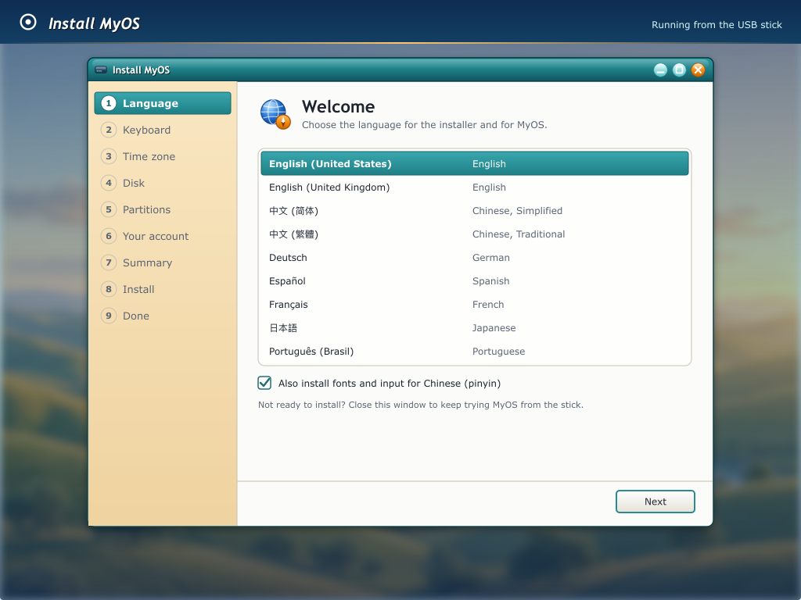
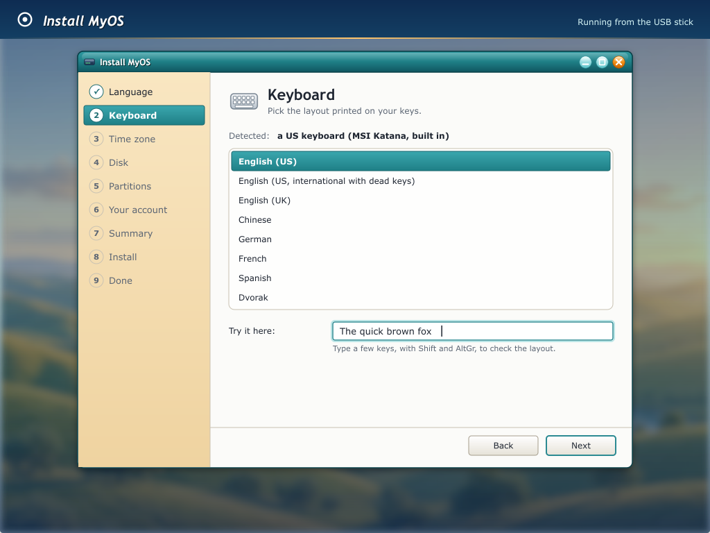
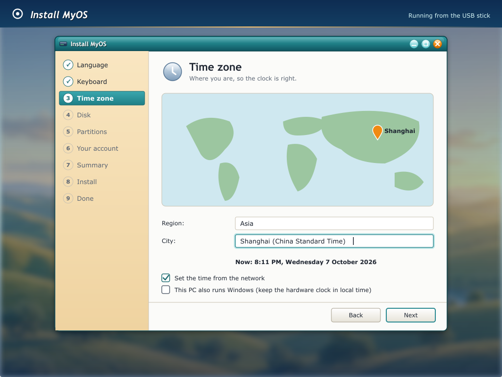
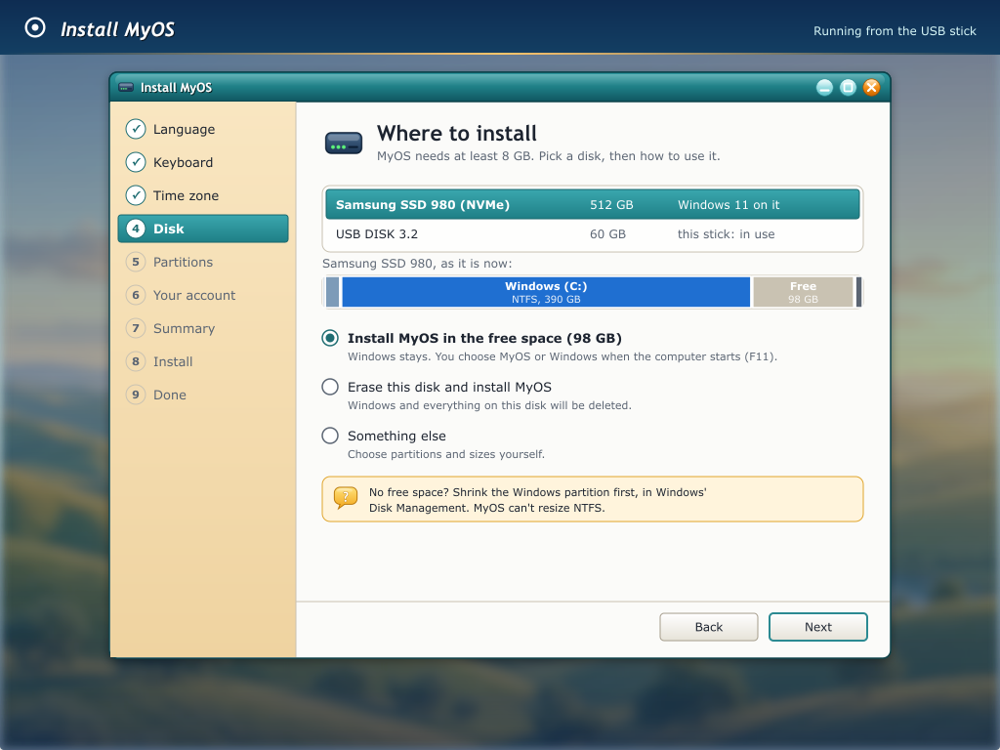
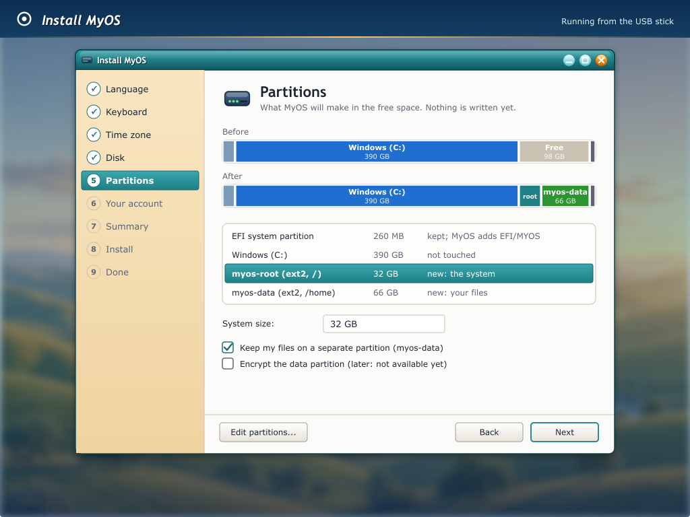
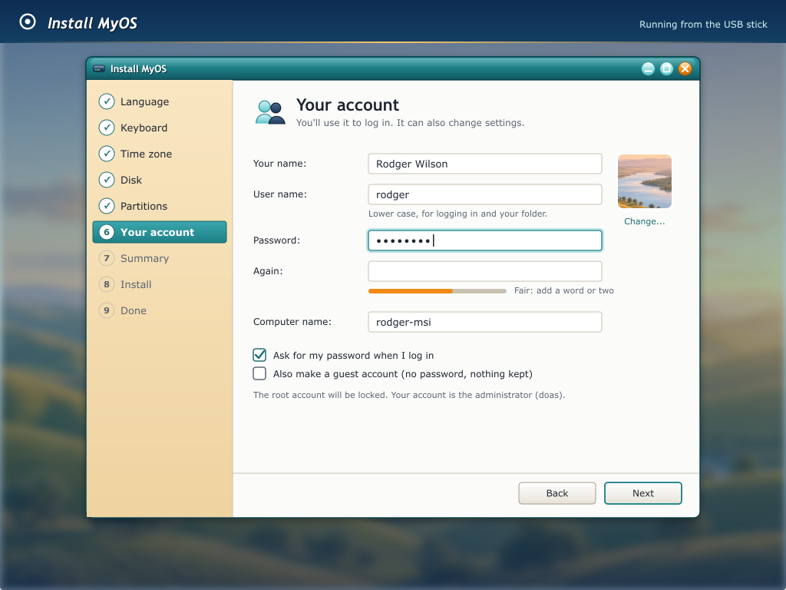
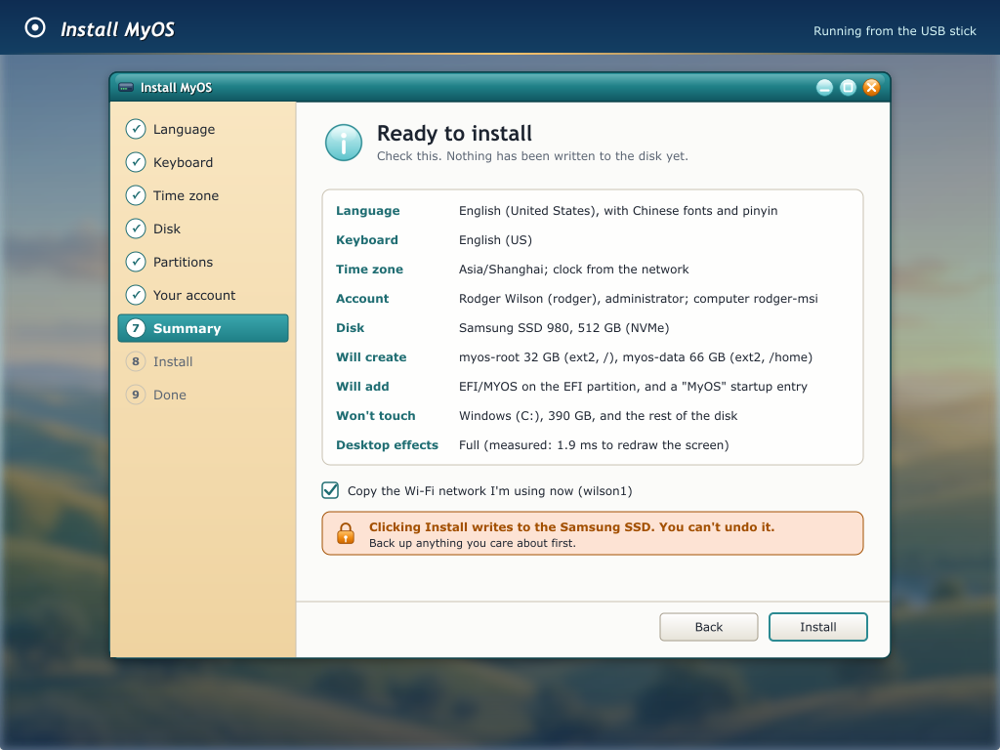
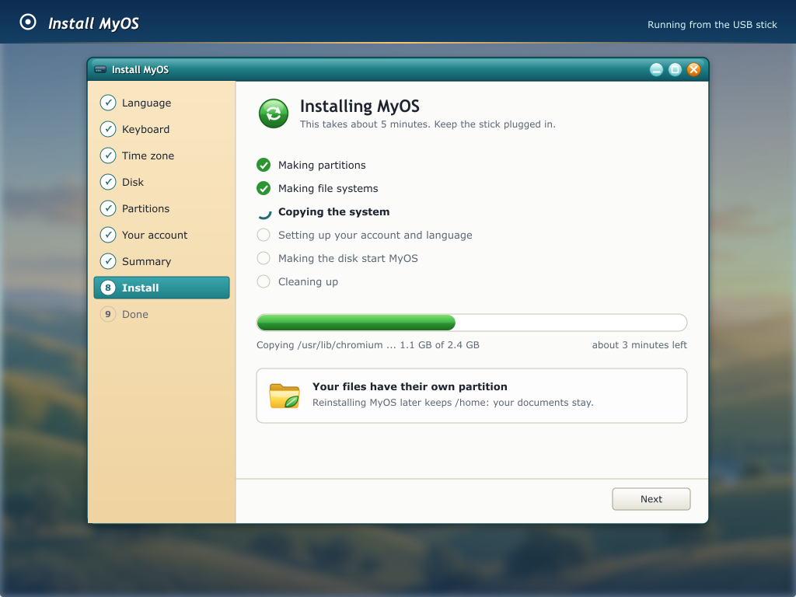
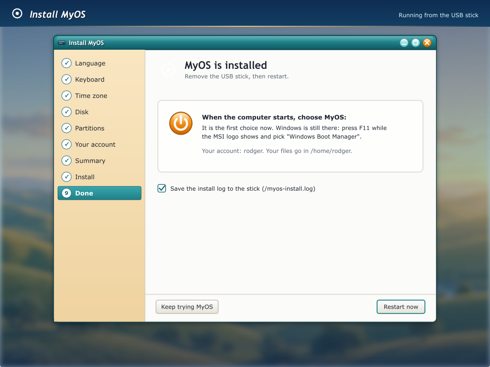

# The installer: MyOS from the stick onto the hard disk

Today MyOS runs from a USB stick (the live system) or from a disk image built
on the Mac (`make hd`). The installer is the program that puts it on a real
machine's own disk, the way Windows Setup or Ubuntu's installer does: it asks
a few questions, partitions the disk, copies the system, and makes the
machine start MyOS without the stick.

Status (2026-10-17): it installs, and `make test-install` proves it in QEMU.
`myos-install` (GTK, or `--text`) writes a plan; `myos-install-helper`
(setuid root) checks it and runs the steps, onto UEFI machines (a GPT;
since 2026-10-10) and BIOS PCs (an MBR, the whole disk; since 2026-10-17).
`make ARCH=x86_64 test-install` installs from the stick onto an empty NVMe,
SATA and USB disk and onto the GPD P2 Max's shape; `make test-install`
(i386) onto an old PC's IDE and SATA disk. Each then starts the new disk
alone and logs in with the new account (live/tools/test-install.py). The MSI's
own SSD is still not visible (VMD). The mockups are drawn by
`live/assets/themes/golden-hour/make-installer.py`.

## What it must do

- Start from the live stick: an "Install MyOS" icon on the live desktop, and
  `myos-install --text` on a machine without graphics (the old PCs).
- Ask, in this order: language, keyboard, time zone, which disk and how to use
  it, partition sizes, the user account and computer name. Then show
  everything on one summary page, and **write nothing to any disk before the
  Install button on that page**.
- Partition the chosen disk, make the file systems, copy the system, set up
  the account, language, keyboard, clock and network, make the disk bootable,
  and offer to restart.
- Work on both kinds of machine MyOS targets:
  - UEFI machines with GPT disks (the MSI, the GPD Pocket 4): x86_64.
  - BIOS machines with MBR disks (the Pentium 4 / Pentium M PCs): i386.
- Keep Windows when there is free space for MyOS next to it, and say plainly
  when there isn't.

## The screens

### 1. Language

The list shows each language in its own script, with its English name beside
it. The choice sets the installer's language and `LANG` for the installed
system (musl reads `LANG`; GTK programs use gettext catalogues, so a language
needs those to be useful). Picking Chinese ticks "fonts and input for Chinese":
CJK fonts (Noto Sans CJK) and a pinyin input method go in with the system.
Closing the window leaves the live system running; nothing has changed.

### 2. Keyboard

The installer suggests a layout from the language. The "Try it here" box
uses the chosen layout as soon as it is picked, so people can check Shift and
AltGr keys before going on. The choice goes to X (an `xorg.conf.d` keyboard
section: XKB layout and variant) and to the text console (a kernel key map).

### 3. Time zone

A region and a city, with the map for pointing; the line under them shows
the local time it gives, so a wrong choice is obvious. The list is tzdata's
own, read when the installer starts: `/usr/share/zoneinfo/zone.tab` has
every zone (418 in tzdata 2026b) with its country and the latitude and
longitude of its city, and every inhabited country has at least one line;
`iso3166.tab` names the countries ("Kolkata, India"). Only Bouvet Island
and Heard & McDonald Islands, which nobody lives on, have none. UTC is
offered too. The map is the real Earth (the mockup's blobs were a
placeholder): Natural Earth's public-domain 1:110m coastlines, cut off at
84°S below the Antarctic stations, made into a C table by
`live/tools/make-worldmap.py` (`live/myos-install/worldmap.h`, about 12 KB), and
drawn equirectangular so every zone's dot sits at its city. A click picks
the nearest dot. The helper only accepts a zone name made of tzdata's
characters (no `.`, so no `..`): it copies `/usr/share/zoneinfo/NAME`. The
choice becomes `/etc/localtime`. "Set the time from the network" turns on an
NTP client. "This PC also runs Windows" matters because Windows keeps the
hardware clock in local time and Linux (and MyOS today) in UTC: if they
disagree, one of them shows the wrong time after every restart.

### 4. Which disk, and how

Every disk the kernel found, with its size and what is on it (a partition
table, the file systems we can recognise, "Windows" when there is an NTFS
partition plus a Windows boot loader on the EFI partition). The stick the
installer runs from is listed but can't be chosen. Below the list, the chosen
disk as a bar of its partitions, and three ways to use it:

- **Install in the free space**: only when there is enough unpartitioned
  space (at least 8 GB). Nothing that exists is touched. MyOS can't resize
  NTFS, so the box says how to make space from Windows itself.
- **Erase this disk**: everything on it goes. The summary page names what will
  be lost.
- **Something else**: the partition manager on the next page, for people who
  know what they want.

### 5. Disk & partitions

Before/after bars on the chosen disk (EFI, Windows, unallocated, then
**myos-root** and **myos-data**), a five-column table (partition, type, size,
mount, action), and a small toolbar (add, resize; delete/format greyed until
they exist). An amber note repeats that nothing is written until **Install**
on the summary page. Default layout:

| machine | partitions |
|---|---|
| UEFI (GPT) | the EFI system partition (FAT32, 260 MB or more; an existing one is kept and shared with Windows, MyOS adds `EFI/MYOS/`), **myos-root** (ext2, `/`, 32 GB by default), **myos-data** (ext2, `/home`, the rest) |
| BIOS (MBR) | the boot area (type 0x7F: stage 2, the boot picture, the kernel, as `make hd` builds it), **myos-root** (ext2, `/`), **myos-data** (ext2, `/home`) |

The kernel finds its partitions by these labels, as it does today, so
nothing needs a disk name written into a configuration file. A separate
`myos-data` means a later reinstall can keep everyone's files. No swap: MyOS
has none (`docs/DESIGN.md`). Encryption is shown greyed out until it exists.

### 6. Your account

Full name, user name (suggested from the name), password twice with a
strength hint, computer name (suggested from the user name and the machine).
The first account is the administrator: it is in `wheel` and may use `doas`.
**root is locked** and **an empty password is refused**: this is where the
live system's two weakest points (empty passwords that accept anything, see
`docs/gaps.md`) stop. A guest account is optional.

### 7. Summary

Every answer on one page, plus exactly what will be written: which
partitions are made, what is added to the EFI partition, and what will not be
touched. The red box says which disk the Install button writes to. "Copy the
Wi-Fi network I'm using now" carries the live session's network (its
`wpa_supplicant` entry) over, so the installed system is online at once.
"Desktop effects" is the compositor level the installer measured
(`docs/ROADMAP.md`: it times a screen redraw, then picks `none`, `xrender` or
`gl` and writes `/etc/myos/desktop.conf`).

### 8. Installing

The steps, each ticked when done, a progress bar driven by bytes copied (the
copy is most of the time), and the current file. There is no Cancel: half a
partition table is worse than waiting. If a step fails, the page shows the
error and the log, and says what state the disk is in.

### 9. Done

Remove the stick and restart. When Windows is still there, the page says how
to reach it (the MSI's F11 boot menu). The install log can be saved to the
stick for a bug report.

## How it is built

Two programs, so the part with root's power is small and has no window:

- **`myos-install`** (GTK, runs as the live user; also `--text` for a
  terminal): asks the questions, checks the answers, and writes a **plan**: a
  plain text file listing every step with its arguments ("make GPT partition
  3: 32 GB, type Linux, label myos-root", "mkfs ext2 on nvme0n1p3", ...). The
  summary page is that plan, in words.
- **`myos-install-helper`** (setuid root, like `myos-adduser`): reads the plan,
  checks it again on its own (it trusts nothing from the window), shows nothing,
  and runs the steps, writing progress lines the window turns into the bar.

The plan is also how the installer gets tested: `make test-install` boots the
live image in QEMU with an empty virtual disk (NVMe, AHCI, IDE), runs the
helper with a written plan, restarts from the new disk without the stick, and
checks the login screen comes up and the account works. The same plan file
makes an unattended install possible.

## Upgrading from the stick

An installed disk can be upgraded without partitioning and without formatting.
The same two programs do it: `myos-install` notices a disk that already has
`myos-root` and `myos-data` (same architecture, MyOS's own EFI partition) and
asks first: **Upgrade** or **Install from the start**. Upgrade skips language,
keyboard, time zone, partitions and the account, and goes to a short summary.
`--text` asks the same question.

What is kept: files on `myos-data`, accounts, the computer name, language,
keyboard, time zone, Wi-Fi, `desktop.conf`, and `myos-config`. What is
replaced: the system on `myos-root` and the boot files. The partition table
is not touched.

**The record.** Every root has `/usr/lib/myos/release` (the stick's build,
the kernel's date-gitid and SHA-256) and `/usr/lib/myos/manifest` (one line
per file the stick shipped, with SHA-256, size and mode). The image's first
boot writes the manifest (`myos-manifest write`). The installer copies both
onto the disk unchanged, so the account and the computer name show up later
as local changes. `uname -v` and `/proc/version` carry the same kernel
version; `uname -r` stays `6.1.0-MyOS`.

**What is kept, file by file.** `myos-manifest diff` sorts each file of the
disk against the disk's manifest and the stick's. A file whose size and
mtime still match its line is taken as unchanged without being read (the
install copies with mtimes kept); only the rest are hashed. A file that
still matches is the system's: the stick replaces it (`replace`). A change
under `/etc`, `/usr/local`, `/opt`, `/root`, `/srv`, `/var/mail` or
`/var/spool` is kept (`keep`); if the stick's copy also moved on since, it
is written beside the kept file as `NAME.myos-new` (`sidecar`). A file this
machine removed from those places stays removed (`deleted`: the stick's ssh
keys, which install takes off). A changed program or library, or one added
outside them (an extra `apk` package's files), is saved under
`/data/.myos-upgrade/<date>/replaced/` and then replaced or removed
(`changed`); such packages must be added again. `passwd`, `group`, `shadow`
and `gshadow` are rebuilt: system accounts and groups from the stick, people
(uid 1000 and up) and their group memberships from the disk; the live user
`myos` is left out. `/var/log` and the live session's own files (its ssh
keys, machine id, Wi-Fi list, root's history) are never copied.

**Space.** Before any write, the helper measures `myos-root` (`statfs`:
free blocks and inodes must cover the diff's `BYTES` and `INODES` plus
128 MiB), `myos-data` (room for the backup, `BACKUP`), and the boot area
(`BLKGETSIZE64`: the EFI partition, or the BIOS type `0x7F` area, must hold
the stick's boot files). The window offers Upgrade only for a disk
`myos-install-helper --probe` calls upgradable (MyOS on it, same
architecture, no Windows on its EFI partition); the space check is the
helper's, at check time.

**The helper's steps:** check (the diff, into `/run/myos-upgrade.diff`),
save (`/etc`, the diff, the changed files, then a marker: a second try
reuses this folder and its diff), copy (`rsync -ax --inplace
--delete-after` with the kept files excluded), merge, boot files last
(`myos-mkesp --without` on UEFI; the stick's boot area and MBR *code* on
BIOS), finish (remove the marker). A power cut leaves `myos-data` whole:
boot the stick and run the upgrade again.

`make test-upgrade` installs onto an empty disk, boots it, plants a home
file, an edited `/etc/motd` and a changed `/usr/bin/ldd` (debugfs, from the
Mac), boots the stick, checks `--probe`, stops the helper after copy, runs
it again, and boots the upgraded disk. x86_64, q35 + NVMe (2026-10-21):
OK in 184 s, the upgrade itself 16 s + 17 s in QEMU; its diff on that disk
was keep 13, changed 4, replace 32444, add 4, deleted 2 (35180 files on
the stick). The stick is the same build as the installed system, so the
`sidecar` case and a real version change are not in it yet.

The steps:

1. **Partition**: write the new table (util-linux's `sfdisk`, already on the
   live disk) and have the kernel read it again.
2. **File systems**: `mke2fs -L myos-root`, `-L myos-data` (e2fsprogs is on
   the live disk); `mkfs.vfat` for a new EFI partition (`dosfstools`: to add).
3. **Copy**: mount the new root and `rsync -aHAX` the running system onto it,
   leaving out what only the live session has (`/tmp`, `/proc`, `/sys`,
   `/dev`, the live user, the stick's overlay of local secrets).
4. **Configure**: `/etc/hostname`, the account (the same code as
   `myos-adduser`: passwd, group, shadow), root locked, `LANG`, the keyboard,
   `/etc/localtime`, the Wi-Fi entry, `desktop.conf`.
5. **Boot**: UEFI: copy `BOOTX64.EFI`, `KERNEL.BIN` and `FONT.BIN` to
   `EFI/MYOS/` and add a "MyOS" boot entry first in the order. BIOS: write the
   MBR and the boot area (what `make hd` does on the Mac today).
6. **Finish**: write the log, `sync`, unmount.

## What MyOS needs first

The installer itself is a few thousand lines of ordinary C and GTK. Most of
the work is in the kernel, and most of it is already on the work list
(`docs/WORKLIST.md`) for other reasons:

| needed | why | today |
|---|---|---|
| **The MSI's own SSD visible** | it's the disk to install to | the MSI's boot log says "storage: no disks" (before USB, that meant nothing found). Probably Intel VMD/RST hides the NVMe behind its own controller: needs a VMD driver, or the BIOS switched to AHCI (which Windows must be prepared for first) |
| **Block device nodes** (`/dev/nvme0n1`, `/dev/sda`...) | `sfdisk`, `mke2fs` and `mkfs.vfat` open the disk as a file | `mknod` makes no block devices (`docs/gaps.md`) |
| **Re-reading a partition table** (`BLKRRPART`, `BLKGETSIZE64` and friends) | after `sfdisk` writes, the kernel must see the new partitions | partitions are scanned once, at boot |
| **`mount` of ext2 and FAT32 at run time**, and `umount` | to copy onto the new root and write the EFI partition | only tmpfs, proc and sysfs mount; nothing unmounts (B27) |
| **FAT32 write** | the boot files go on the EFI partition | read-only (B46) |
| **UEFI runtime services** (`SetVariable`, `efivarfs`) | the "MyOS" boot entry (`efibootmgr`) | not mapped after ExitBootServices. Without them the installer could only use the fallback path `EFI/BOOT/BOOTX64.EFI`, which Windows also uses |
| **Hard links** (`link`) | `rsync -H`, and `useradd`/`passwd` (they lock with a hard link) | `EPERM` (B12) |
| **Real passwords at the login screen** | the account the installer makes | empty passwords accept anything (B34) |
| **Console key maps** | the keyboard choice for the text console | US layout, scancode set 1 only |
| **The hardware clock in local time** (an option) | dual boot with Windows | the kernel assumes UTC |
| **ext4** (later) | ext2 has no journal: a power cut mid-write needs `e2fsck` | ext2 only (B45) |
| **`dosfstools`, `efibootmgr`, Noto CJK fonts, a pinyin input method** | packages for the live disk's list | Noto CJK is in (`[fonts]`, 2026-10-09); the rest not yet |

A good order: the MSI's SSD, block devices with partition re-reading, run-time
mounts with FAT32 write, then the installer's text mode (testable in QEMU at
every step), then UEFI boot entries, then the GTK window. The old-PC (BIOS)
path can come first in QEMU, because its boot area already exists (`make hd`).

## Questions for Rodger

- Is "install next to Windows" needed on the MSI, or is erasing it fine? (It
  decides how soon UEFI boot entries are needed.)
- Should `/home` be its own partition by default (as drawn), or one big root?
- Which languages besides English and Chinese are worth the space on the stick?
- Should the installed system keep the developer tools (gcc, the MyOS source)
  that the live disk carries, or leave them out to save space?
