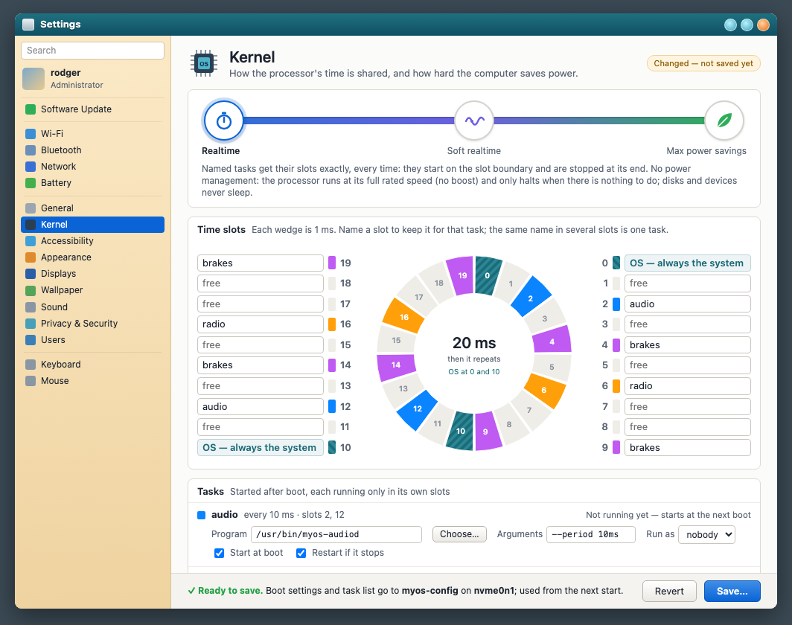
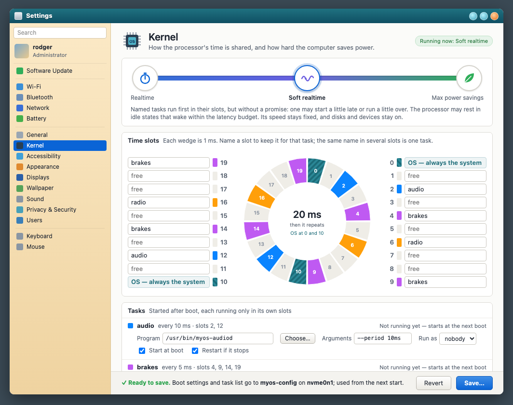
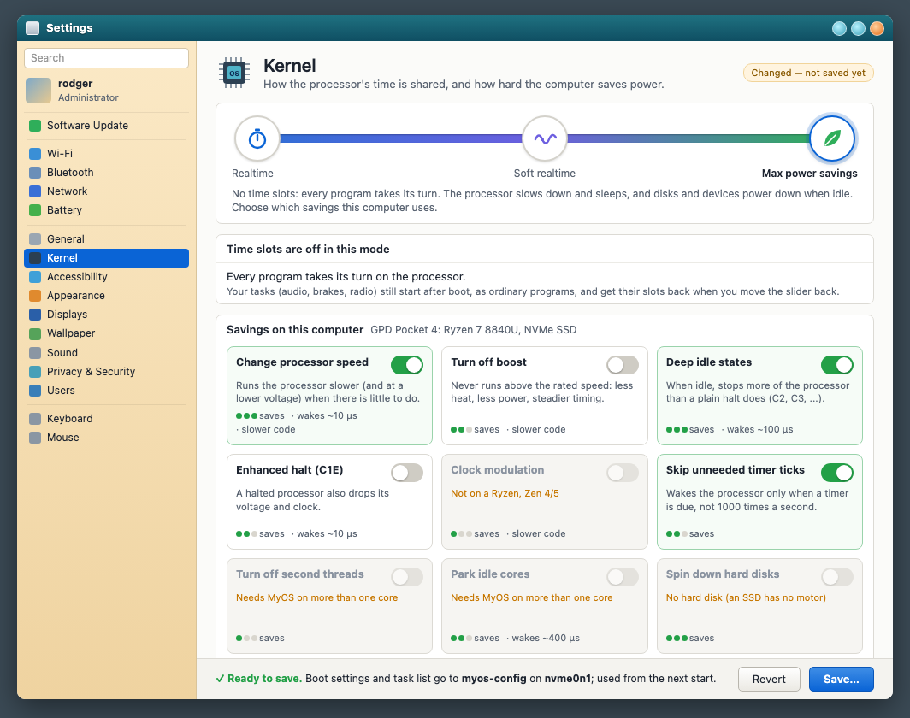
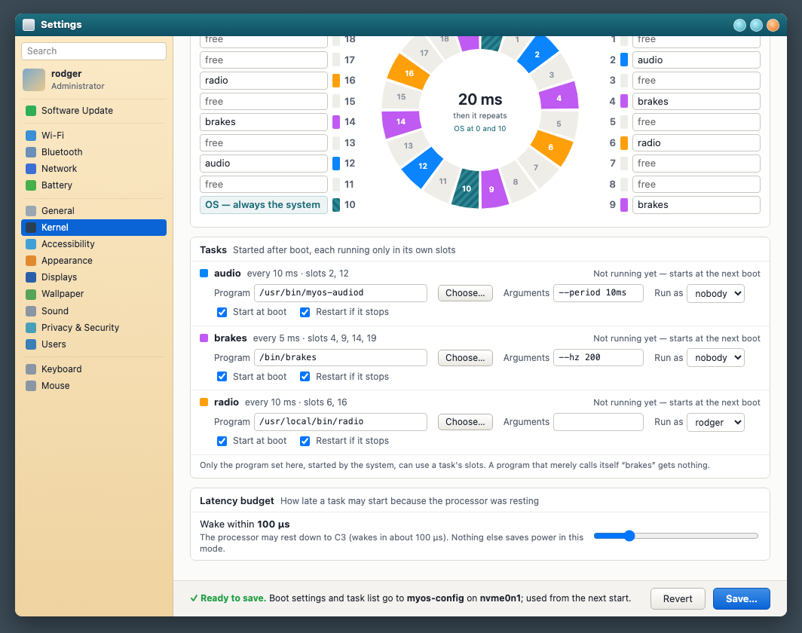
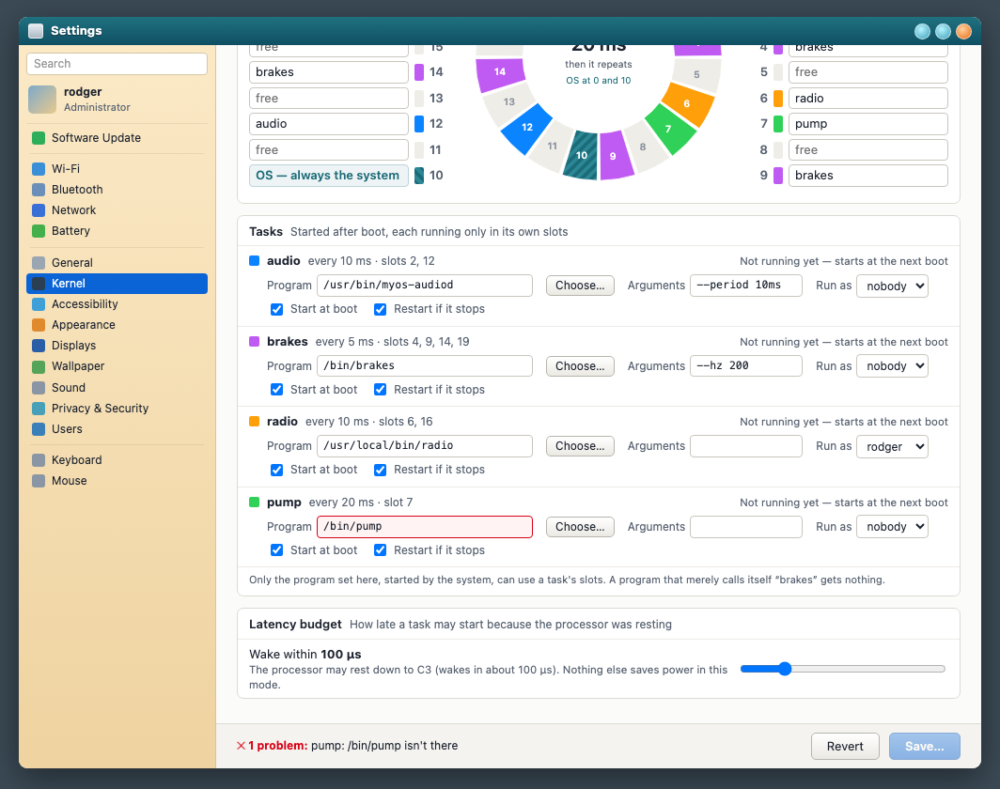
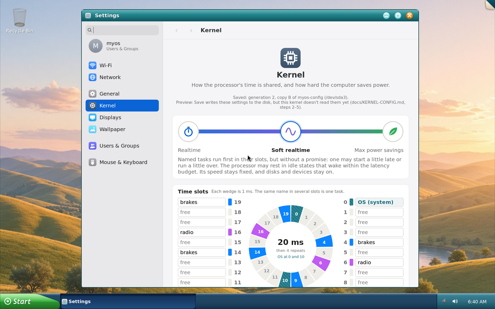

# Kernel configuration: the Settings › Kernel screen and the config on disk

Status: **design, with Settings built ahead.** This document, the chosen
mockup (B) and the Python reference exist. **Settings › Kernel works** on
the x86_64 live disk: it saves both parts to `myos-config`, and they read
back (2026-10-10). The kernel doesn't read the config yet; the steps are in
§10. Who runs in which slot, and how the desktop keeps answering, is in
**docs/TIME-SLOTS.md**.

## 1. The idea

Settings gets a **Kernel** screen. At the top, a slider picks one of three
modes: **Realtime**, **Soft realtime**, or **Max power savings**. In the
two real-time modes you name the tasks that own the 20 time slots, and
say which program each task runs (`brakes` → `/bin/brakes`). In power
savings you switch on the savings this processor and these devices have.

The config has **two parts**. They are used at different times, but
saved together:

| | **Boot settings** | **Task list** |
|---|---|---|
| Holds | The mode; which task owns which slot; the latency budget; the power savings | For each task: the program, its arguments, the user it runs as, whether it starts at boot and is restarted when it stops |
| Size | 512 bytes (one sector) | 5 KiB (ten sectors) |
| Used | **At boot**, by the kernel, before any file system is mounted | **After boot**: `myos-taskd` starts the programs, and the kernel lets only those programs into the slots |

**Save** checks that everything makes sense, then packs both parts in the
byte order of the processor the kernel is built for. It writes them to a
small partition of the disk, not encrypted. The kernel reads them early
at every start, checks them again, and runs that way.

```
 Settings                     the disk (myos-config)               at boot / after boot
 ┌──────────────┐  Save   ┌───────────────────────────┐  boot   ┌─────────────────────────┐
 │ slider, slot │ ──────▶ │ copy A: boot block (512 B) │ ──────▶ │ kernel: mode, slots,    │
 │ names, the   │ checks, │         task list   (5 KiB)│ reads   │ power; keeps task list  │
 │ programs,    │ encodes │ copy B: the same, older    │         ├─────────────────────────┤
 │ power cards  │         │         (or newer)         │         │ myos-taskd: starts      │
 └──────────────┘         └───────────────────────────┘         │ /bin/brakes → slots     │
                                                                 └─────────────────────────┘
```

## 2. The three modes

| | Realtime | Soft realtime | Max power savings |
|---|---|---|---|
| Time slots | **Exact.** A task starts on its slot boundary and is stopped at its end. | **Preferred.** A task runs first in its slot, but may start a little late or run a little over. | **Off.** Every program takes its turn. The tasks still start, as ordinary programs. |
| Processor speed | Fixed at the rated speed, no boost | Fixed at the rated speed, no boost | Varies (you choose the range) |
| When idle | Halt only (C1: wakes in about 1 µs) | Idle states that wake within the **latency budget** | Down to the deepest state you allow |
| Disks and devices | Always on | Always on | Spin down or sleep, as you choose |
| Timer | 1 ms tick, always | 1 ms tick, always | Ticks only when needed (if switched on) |
| Good for | Control loops, audio with tiny buffers, measuring | A desktop that also plays audio or runs a control task | Laptops on battery; anything without deadlines |

What "no guarantee" means in soft realtime: a slot is a promise of
**priority**, not of exact times. Three things may move a task:
- an interrupt's work (in realtime that work is pushed to an OS slot);
- waking from an idle state;
- finishing a short section it was already in.

The **latency budget** (1–1000 µs, default 100) bounds the idle part:
the kernel only uses idle states that wake that fast. Nothing else saves
power in soft realtime, so code runs at the same speed in every slot.

Realtime turns power management off. The idle thread still halts (`hlt`,
C1), because spinning would only make heat; C1 wakes in about a
microsecond. Whether realtime should spin instead, for the lowest
possible jitter, is open question 5.

## 3. Time slots and tasks

- One **frame** is 20 slots of 1 ms, **numbered 0–19**. It repeats every
  20 ms.
- **Slots 0 and 10 always belong to the OS**: the kernel and the system's
  own programs run then, exactly every 10 ms. The screen shows them
  locked.
- Each of the other 18 slots has a **name field**. Empty means free:
  ordinary programs (the desktop, the shell) share the free slots, plus
  any time a task leaves unused, round robin.
- **A name is a task.** The same name in several slots is one task:
  `brakes` in 4, 9, 14 and 19 runs every 5 ms. The screen shows each
  task's rhythm ("every 5 ms", or "uneven: 2/8/10 ms").
- **A task is a program.** Typing a new name adds a row to the task list
  with the program `/bin/<name>` filled in, to keep or change (§4).
- Names: 1–15 characters, a small letter first, then `a–z 0–9 - _`. `os`,
  `idle`, `main` and `kernel` are taken.

> **Kernel change (done 2026-10-13):** the scheduler numbered the slots
> 1–20 and gave the system 1 and 10, 9 ms then 11 ms apart. Now they are
> 0–19, the system at 0 and 10, exactly 10 ms apart (§10, step 1).

## 4. After boot: starting the tasks

(The full rules, including the OS class that keeps the desktop answering,
are in docs/TIME-SLOTS.md.)

Your example: slot 2 is labelled `brakes`, and `brakes` runs `/bin/brakes`.
What happens at each start:

1. **The kernel reads both parts** from `myos-config`, in `storage_init()`.
   This is before `sched_start()` and before any file system, so it's
   10 more sectors on a read the kernel already does.
   - It uses the **boot settings** at once: the mode, the slot table and
     the power savings.
   - It **keeps the task list**: `/bin/brakes`, its arguments and its
     user. It doesn't start anything yet, because `/bin` isn't mounted.
2. **Until `brakes` runs, slot 2 is reserved but empty.** With "leftover
   time to programs" on (the default), ordinary programs use it. Nothing
   waits on a task that hasn't started.
3. **The root file system is mounted**, and init starts **`myos-taskd`**,
   the first service in runit's stage 2, before the login screen. It
   reads the task list the kernel kept, from `/sys/kernel/myos/tasks`. It
   reads no file of its own, so it can't disagree with the kernel. Then,
   for each task marked "start at boot", it:
   1. forks;
   2. asks the kernel to make the child task `brakes`, which only root
      may ask;
   3. switches to the task's user and group;
   4. runs `/bin/brakes --hz 200`.
4. **The kernel binds at `execve`.** The child becomes task `brakes`, and
   gets slots 4, 9, 14 and 19 from the next frame, only if all of these
   hold:
   - it was marked by root;
   - the file being run is `/bin/brakes`: the same file, compared by
     inode, not by name;
   - it runs as the configured user;
   - no living process is `brakes` already.

   If any check fails, `execve` fails with `EPERM`, and `myos-taskd` logs
   why.
5. **When it stops**, the slots are empty again and leftover time fills
   them. With "restart if it stops" on, `myos-taskd` waits the restart
   delay (1 s by default) and starts it again from step 3.
6. **In max power savings**, `myos-taskd` still starts the tasks, as
   ordinary programs without slots, so the machine still does its job;
   it just has no timing promise.

**This closes a hole the kernel has today.** `sched.c` gives a slot to
any thread with the right *name* (`thread_find`). Any program can rename
itself with `prctl(PR_SET_NAME, "brakes")`, so any user could take
`brakes`'s slots. Under the new rule a name gives nothing: only the
configured program, started through root, is let in.

Why `myos-taskd` and not the kernel itself: starting a program needs its
user, its arguments, somewhere for its output, and supervision when it
stops. runit already does that for every other service, so the kernel
only checks the binding. (Open question 6 asks about starting tasks even
earlier.)

## 5. Max power savings: what each processor has

The screen lists every saving MyOS knows, and greys out what this
computer lacks, with the reason ("Not on a Pentium M", "No hard disk",
"Needs MyOS on more than one core"). The list and the reasons come from
`tools/kconfig/powerfeatures.py`:

| bit | Saving | Pentium 4 | Pentium M | Ryzen (Pocket 4) | Tuned by |
|---|---|---|---|---|---|
| 0 | Change processor speed | some models | yes (SpeedStep) | yes (CPPC) | speed range, energy preference |
| 1 | Turn off boost | – | – | yes | |
| 2 | Deep idle states | – | yes (C2–C4) | yes (C2, C3, C6) | deepest state |
| 3 | Enhanced halt (C1E) | some models | – | yes | |
| 4 | Clock modulation | yes | yes | – | |
| 5 | Skip unneeded timer ticks | yes | yes | yes | |
| 6 | Turn off second threads | needs SMP | – | needs SMP | |
| 7 | Park idle cores | – | – | needs SMP | |
| 8 | Spin down hard disks | machine | machine | machine | minutes |
| 9 | SATA link power management | machine | machine | machine | |
| 10 | NVMe power states | – | – | machine | |
| 11 | PCIe link power management | machine | machine | machine | |
| 12 | Suspend idle USB devices | machine | machine | machine | |
| 13 | Wi-Fi power save | machine | machine | machine | |
| 14 | Power down the sound chip | machine | machine | machine | |
| 15 | Idle unplugged Ethernet | machine | machine | machine | |
| 16 | Graphics power management | – | – | machine | |

"machine" means the devices decide: an old laptop has an IDE disk and no
PCI Express, while the Pocket 4 has an NVMe SSD and no Ethernet port.
`python3 tools/kconfig/powerfeatures.py pentium-m` prints, for one
family, how each saving works (the MSRs, CPUID bits and commands
involved).

Display dimming, screen-off and sleep timers are **not** kernel settings.
They stay with the session's power daemon and its text file
(`docs/power-performance-settings.md` §2.4.2).

## 6. Save: the safety checks

Save runs these checks before anything is written. The kernel runs the
boot-settings checks again when it reads the boot block, and the
task-list checks again before it binds a program. `kconfig.py check` is
the reference.

**Errors** (Save is greyed out and the footer says why):
- **Slots:**
  - slots 0 and 10 aren't the OS, or another slot claims to be;
  - a name breaks the naming rule, or is a reserved name;
  - no free slot and "leftover time to programs" is off (nothing else
    could run).
- **Soft realtime:** the latency budget is outside 1–1000 µs.
- **Power savings:**
  - a saving switched on that this processor can't have;
  - a speed range other than 10% ≤ slowest ≤ fastest ≤ 100%;
  - a deepest idle state this processor doesn't have;
  - disk spin-down outside 1–600 minutes.
- **Tasks:**
  - a task with no program;
  - a program path that isn't absolute, or contains `..`;
  - a program that isn't there or isn't executable;
  - **a program anyone but root can change**: the file, or a folder
    above it, is writable by others, or the program runs as root but
    root doesn't own it. Whoever could change the file would own a
    real-time slot, and maybe root;
  - arguments longer than 95 bytes, or with characters that can't be
    stored.

**Warnings** ("Save anyway?"):
- fewer than 2 free slots: the desktop gets little time;
- a task that runs as root: it has full control of the computer;
- a task that doesn't start at boot: its slots stay empty until
  something starts it;
- power savings with every saving off;
- a saving that needs SMP: it does nothing yet;
- disk spin-down under 10 minutes: frequent stop-start wears disks out.

**Notes**: each task's slots and rhythm; in soft realtime, the deepest
idle state the budget allows; in power savings, that the tasks still
start without slots.

Save asks for an administrator's password, like Users & Groups does,
because the setting affects everyone on the computer.

## 7. On the disk

### The boot block (512 bytes)

Every field sits at a fixed offset, aligned to its own size, so the
kernel can use the block as a plain C struct once the byte order matches.
`kconfig.py header` prints the structs; they compile to these offsets
with both `i686-elf-gcc` and `x86_64-elf-gcc`.

| Offset | Size | Field | Meaning |
|---|---|---|---|
| 0x000 | 8 | magic | `MYOSKCFG` |
| 0x008 | 1 | byte_order | 1 little-endian, 2 big-endian |
| 0x009 | 1 | version | 1 |
| 0x00A | 1 | arch | 1 i386, 2 x86_64, 3 arm, 4 arm64 |
| 0x00B | 1 | mode | 0 realtime, 1 soft realtime, 2 power saving |
| 0x00C | 2 | size | 512 |
| 0x00E | 2 | slot_us | 1000 |
| 0x010 | 4 | generation | +1 on every save; the task list has the same |
| 0x014 | 4 | crc32 | CRC-32 (IEEE) of the block, this field 0 |
| 0x018 | 1 | nslots | 20 |
| 0x019 | 1 | ntasks | names used |
| 0x01A | 2 | os_slot | 0, 10 |
| 0x01C | 4 | rt_flags | bit 0 leftover time to programs, bit 1 defer interrupt work (realtime) |
| 0x020 | 20 | slot_owner | per slot: 0 free, 1–18 a task, 0xFF the OS |
| 0x034 | 2 | latency_budget_us | soft realtime |
| 0x036 | 10 | reserved | 0 |
| 0x040 | 288 | task_name | 18 × 16 bytes, NUL-padded |
| 0x160 | 4 | power_on | savings switched on (bit numbers from §5) |
| 0x164 | 4 | power_seen | savings this machine had when saved |
| 0x168 | 1 | cpu_min_pct | slowest speed, % of rated |
| 0x169 | 1 | cpu_max_pct | fastest speed |
| 0x16A | 1 | epp | energy preference 0 (speed) – 255 (energy) |
| 0x16B | 1 | cstate_max | deepest idle state, 1 = C1 … 6 = C6 |
| 0x16C | 2 | spindown_min | minutes, 0 never |
| 0x16E | 146 | reserved | 0, room for later versions |

### The task list (5 KiB)

A 64-byte header, then one 256-byte entry per task, in the boot block's
task order:

| Offset | Size | Field | Meaning |
|---|---|---|---|
| 0x000 | 8 | magic | `MYOSTASK` |
| 0x008 | 1 | byte_order | the boot block's |
| 0x009 | 1 | version | 1 |
| 0x00A | 1 | ntasks | the boot block's |
| 0x00C | 4 | size | 5120 |
| 0x010 | 4 | generation | **the boot block's**: the two belong together |
| 0x014 | 4 | crc32 | CRC-32 of the 5120 bytes, this field 0 |
| 0x018 | 2 | entry_size | 256 |
| 0x040 | 18 × 256 | task[] | the entries below |

| Entry offset | Size | Field | Meaning |
|---|---|---|---|
| 0x00 | 16 | name | the same name as the boot block's |
| 0x10 | 128 | program | absolute path, NUL-terminated |
| 0x90 | 96 | args | each argument NUL-terminated, then an empty one |
| 0xF0 | 4 | uid | runs as this user … |
| 0xF4 | 4 | gid | … and group |
| 0xF8 | 2 | flags | bit 0 start at boot, bit 1 restart if it stops |
| 0xFA | 2 | restart_ms | wait before a restart |
| 0xFC | 4 | reserved | 0 |

### How the parts are kept straight

**Byte order.** Settings writes both parts in the byte order of the
processor the kernel is built for: little-endian for i386 and x86_64,
either for ARM. The `byte_order` byte comes before any multi-byte field,
so a reader can tell the order before reading a number. The kernel takes
a block only if `byte_order` and `arch` are its own, so it never swaps
bytes. A config written for another machine is ignored, and the kernel
says so. `kconfig.py demo` prints the boot block in both orders: only
the numbers change; names, slot owners and the magic stay as they are.

**Single-byte owners, separate names.** Each slot holds a 1-byte owner
number, and the names are stored once. The kernel rebuilds its slot table
with 20 byte reads, and a name can never disagree with itself between
slots.

**Two copies, A and B, and the order of writing.** Save overwrites the
copy not in use:
1. its task list, then flush;
2. its boot block, then flush;
3. read both back.

A copy counts only if both parts pass their CRC and checks **and carry
the same generation**. At boot the kernel uses the newer such copy. A
power cut between the two writes leaves the new task list beside the old
boot block. Their generations don't match, so the kernel uses the other
copy: the computer starts with the settings it had.
`kconfig.py demo` shows this case. The generation compares like TCP
sequence numbers, so it may wrap past 2³².

**Versions.** A later version only adds fields in the reserved space,
and old kernels ignore them. A block whose `version` the kernel doesn't
know is skipped, never half-read.

**Bits a machine lacks.** If the disk moves to another computer, a
saving switched on in the block may not exist there. The kernel skips
it and logs that. `power_seen` lets Settings say "this was saved on a
machine that had X".

**Not encrypted, on purpose.** Nothing in either part is secret, and the
kernel must read them before anything could unlock a key. Integrity is
what matters, and three things protect it:
- the CRCs catch damaged blocks;
- only root can write the partition;
- the kernel re-checks everything, including the program file itself
  when it binds.

A config someone crafted by hand can only pick what Save could also pick.

## 8. Where it lives, and how the kernel finds it

**Recommended: a partition named `myos-config`.** The partition table
already tells the kernel where it is, so no other pointer is needed.
- **GPT** (the installer, the Pocket 4): a 1 MiB partition named
  `myos-config` with MyOS's own partition type GUID. Partition editors
  leave a named partition alone. The kernel already reads GPT names
  (`PARTNAME`, `fs/partition.c`). Inside it, in 512-byte sectors:

  | Sectors | What |
  |---|---|
  | 0 | boot block, copy A |
  | 1 | boot block, copy B |
  | 16–25 | task list, copy A |
  | 32–41 | task list, copy B |
  | the rest | room for later |

- **A hybrid MBR** (the live stick and UTM images, made by
  `tools/mkuefi.py`): USB firmware wants real MBR entries, so these
  disks have no 0xEE entry. Without one the kernel reads only the MBR,
  and GPT names are invisible. So `myos-config` is also MBR entry 3,
  type 0xDA (non-filesystem data). `myos-kconfig` finds it either by
  `PARTNAME`, or, failing that, by reading the GPT from the whole disk
  (read-only) and matching its first sector. (The kernel's own reader,
  step 3, will need the same: read the GPT when its header is at LBA 1,
  even behind a hybrid MBR.)
- **MBR** (old PCs): MyOS's own 0x7F boot area already holds stage 2,
  the kernel and the initramfs as raw sectors (`tools/mbr-partition.sh`).
  Its **last 64 sectors** (32 KiB) hold the same layout.
- **Which disk:** the disk the root comes from, by the same rule the
  kernel uses for `myos-root` and `myos-data`. A live stick has its own,
  and never uses an installed system's.
- **When:** in `storage_init()`, which already runs before
  `sched_start()`. The modes and slots are in place before the first
  program runs, and no boot loader change is needed, on BIOS, UEFI or
  (later) the Pi.

**Writing goes through the kernel.** Settings doesn't need to know any
sector numbers. Two root-only files take the two parts:
`/sys/kernel/myos/config` (the boot block) and `/sys/kernel/myos/tasks`
(the task list). The kernel re-checks them, writes the older copy in the
order above, and flushes the drive. Reading either file gives the copy
in use, and `myos-taskd` reads the task list from there. A setuid
helper (like `myos-adduser`) checks the administrator's password and
does the writes. **v1 applies a new config at the next start**;
changing it while running comes later (§10).

Alternatives considered:
- **Inside the kernel file** (Rodger's idea, 2026-10-10). The kernel
  image starts with a jump over a reserved area:

  ```
  offset 0    jmp start         (x86: 2 bytes short, 5 bytes near)
  offset 8    "MYOSKCFG" …      the config, at a fixed, aligned offset
  offset N    start:            the kernel's first real instruction
  ```

  - **For:**
    - the boot loader already loads the whole file, so the config is in
      memory at the kernel's first instruction, before any driver;
    - no partition and no search;
    - the same on BIOS and UEFI;
    - Linux does something like it: its boot protocol header sits at a
      fixed offset in the kernel image, after a jump.
  - **Against:**
    - Save must rewrite the kernel file in place. That is easy in the
      BIOS boot area, but on UEFI the file is on the FAT partition MyOS
      can't write. It would mean writing the file's sectors directly, by
      their position on the disk;
    - a bad or torn write of the first sector also breaks the jump, and
      the computer no longer starts. The separate partition can't do
      that;
    - every new kernel overwrites it, so updating the kernel must carry
      the config across;
    - a signed kernel (Secure Boot, later) can't be patched at all.
  - **Where it fits best:** for the **built-in default** (§10, step 2).
    The build puts the default config in that header, so the kernel has
    a good config at its first instruction. The partition overrides it
    once the disk is read.
- **A fixed sector before the first partition** (e.g. LBA 2046–2047).
  Simpler, but nothing marks it as used. GRUB on an MBR disk puts its
  core image in the same gap, and wiping tools zero it.
- **The boot loader reads the config and hands it over** in `bootinfo`.
  The settings would arrive before any disk driver, but every loader
  (BIOS stage 2, UEFI, the Pi) would need its own copy of the finding
  logic. Nothing uses the settings before `storage_init()` anyway.
- **The task list as a text file in `/etc`.** `myos-taskd` could read
  one, but then the slot table and the programs could come from two
  different saves, and the kernel would have no list to check a binding
  against.

## 9. The Settings screen: mockup B

Rodger chose **mockup B** out of three (2026-10-10); A (a timeline bar and
a list) and C (a table with the raw block) were deleted.

| Realtime | Soft realtime | Max power savings |
|---|---|---|
|  |  |  |

| The task list | A new name: `pump` in slot 7 |
|---|---|
|  |  |

**Built** (2026-10-10, `live/myos-settings`): the real page on the
x86_64 live disk in QEMU, showing a config `myos-kconfig` had just saved:



- **The slider** has three big stops with pictures (a stopwatch, a wave,
  a leaf), and under it a sentence saying what the mode does.
- **The time slots are a wheel**: the 20 ms frame as a clock, 20 wedges
  of 1 ms. The OS wedges sit at 12 and 6 o'clock, so "every 10 ms" shows
  at a glance. Each name field sits beside its wedge: slots 0–9 on the
  right, top to bottom, and 10–19 on the left, bottom to top.
- **Tasks**, under the wheel: one row per task, with:
  - its colour, rhythm and slots;
  - whether it's running;
  - **Program** (with Choose…);
  - **Arguments**;
  - **Run as**;
  - **Start at boot** and **Restart if it stops**.

  A footnote says only that program, started by the system, can use the
  task's slots. A new name gets `/bin/<name>`. If there's no such
  program, the field turns red and Save is blocked ("pump: /bin/pump
  isn't there").
- **Soft realtime** adds the latency budget under the tasks.
- **Max power savings** replaces the wheel and tasks with a note: the
  tasks still start, without slots. It then shows a **grid of cards**,
  one per saving, each with:
  - its switch;
  - what it does;
  - how much it saves (●●○);
  - how slowly it wakes;
  - whether it slows running code.

  A saving this computer lacks stays as a greyed card with the reason
  ([mockup-b-2-pentium-m.png](kernel-config/mockup-b-2-pentium-m.png)
  is the same page on an old Pentium M laptop).
- **The footer** shows the checks' result, **Revert** and **Save…**
  (Save asks for an administrator's password).
- **The header badge** says "Running now: …", "Changed — not saved yet"
  or "Saved — used after a restart".

The interactive page is
[kernel-config/mockups.html](kernel-config/mockups.html):
- the slider, the name fields and the task fields all work, with the
  checks above;
- a menu pretends the computer is a Pentium M laptop, a Pentium 4
  desktop, or the Pocket 4;
- `#b-0`, `#b-1` and `#b-2` open it at each slider position.

Still to design: a saving's own settings (speed range, energy
preference, deepest idle state, disk spin-down minutes) have no place in
B's cards yet. They could open inside a card when it is switched on
(open question 1).

## 10. Steps (each ends with something to see in QEMU)

1. **Slots 0–19, OS at 0 and 10.** *Done 2026-10-13.* `sched.c` and
   `slots.conf` renumbered (`slots2c.awk` is gone: step 2 replaces it).
   `make test` shows main in 0 and 10, `brakes` in 4, 9, 14, 19.
2. **The built-in default.** *Done 2026-10-13* (`kconfig.py cdefault`,
   `kernel/kconfig.c`, `kernel/kconfig_test.c`; its mode is realtime, what
   the scheduler does until step 6 — §11 question 2 is still open). The
   build turns `config/slots.conf` into both parts with `kconfig.py` and
   links them in. The kernel decodes
   and checks them at boot and prints the mode and tasks. Self-tests
   feed it damaged parts and check it falls back correctly:
   - a bad CRC;
   - the wrong byte order;
   - the wrong arch;
   - a task list whose generation doesn't match its boot block.
3. **Reading from disk.** *Done 2026-10-13 for GPT and hybrid-MBR disks*
   (the installer, `mkuefi.py --config-file`): the kernel looks on the
   root's disk (no root: the first good one), picks A or B, and logs
   which. `make ARCH=x86_64 test-uefi-shell` boots with
   `tools/kconfig/test.conf` in it and checks the kernel used it. Not
   yet: the BIOS disks' copy in the 0x7F boot area (§8), and the slot
   owners are all the kernel applies (the modes: step 6).
4. **Binding by program, not by name.** The root-only "make my child
   task T" call, the check at `execve` (inode, user, one process per
   task), and `EPERM` otherwise. `make test` shows a renamed thread
   getting no slot, and a correctly started one getting its slots.
5. **`myos-taskd`**: a runit service that starts each task, restarts it
   when it stops, and logs. In QEMU, `/bin/brakes` (a test program)
   prints the slot it runs in.
6. **The three modes in the scheduler.** Realtime runs exact slots;
   soft realtime prefers tasks and idles within the budget; power
   saving runs round robin. `make bench` measures slot jitter in each
   mode (`docs/performance.md`).
7. **`/sys/kernel/myos/config` and `…/tasks`** and the setuid helper:
   write, re-check, A/B, read back.
8. **Settings › Kernel**, built as mockup B (§9). **Done early**
   (2026-10-10): `myos-settings.c` (the page), `kconfig.c` (shared with the
   helper; the same bytes as `kconfig.py`), `myos-kconfig.c` (the setuid
   helper that writes the partition). A saving's settings sit inside its
   card once it is switched on.
9. **Each power saving**, one at a time, on hardware that has it, with a
   before/after number for each in `docs/performance.md`.
10. Later: apply without restarting (the task list first: restart only
    the changed tasks), and SMP (second threads, parking cores).

## 11. Open questions for Rodger

1. **Where B's cards keep their settings** (speed range, deepest idle
   state, spin-down minutes): built inside the card once it is switched on.
   Keep it, or a small pop-over from the card?
2. **The default when no config exists** (a new install, or both copies
   bad): soft realtime with `config/slots.conf`'s tasks (recommended),
   realtime as the kernel runs today, or power savings?
3. **Where the kernel finds what Settings saved:** the `myos-config`
   partition (recommended), the kernel file's own header (Rodger's idea,
   §8: recommended for the built-in default), or a fixed sector?
4. **The user a new task runs as:** `nobody` (recommended: the least it
   can be), or the administrator who saved it?
5. **Realtime idle:** halt (C1, recommended), or spin for the last
   microsecond of jitter, at the cost of heat?
6. **How early tasks start:** first thing in runit's stage 2
   (recommended: about a second after the kernel is up), or straight
   from the kernel right after the root is mounted, before init?
7. **Soft realtime:** is "slots preferred + idle within a latency budget"
   what you meant by "no guaranteed time on or off the processor"?
8. **Battery vs mains:** one config for both, or two sets of power
   switches like `docs/power-performance-settings.md` has (more blocks in
   the same partition)?

## 12. The programs that document this

- **`tools/kconfig/kconfig.py`** — both parts:
  - layout and checks, including the program-file checks against a
    system's root (`--root`);
  - encode and decode in both byte orders;
  - the A/B and generation rule;
  - a whole partition image (`partition`, `decode`);
  - the C structs.

  `kconfig.py demo` walks through one config from start to end, power
  cut included.
- **`tools/kconfig/powerfeatures.py`** — every saving, which processors
  have it, how each works, and what soft realtime allows for a given
  budget.
- **`docs/kernel-config/example.conf`** — the text form `kconfig.py`
  reads, with three tasks and their programs.

## 13. How this relates to docs/power-performance-settings.md

That document came first. It describes two modes and a text file under
`/etc/myos`. This one replaces its **mode, slot and task parts**:
- three modes instead of two;
- the kernel's settings and the task list on the disk, read before any
  file system is mounted, instead of a parsed text file;
- slots numbered 0–19, with the OS at 0 and 10;
- a task bound by its program file, checked at `execve`, instead of a
  one-time bind token.

Its display, sleep, lid and battery parts are unchanged, and stay with
the session's power daemon.
